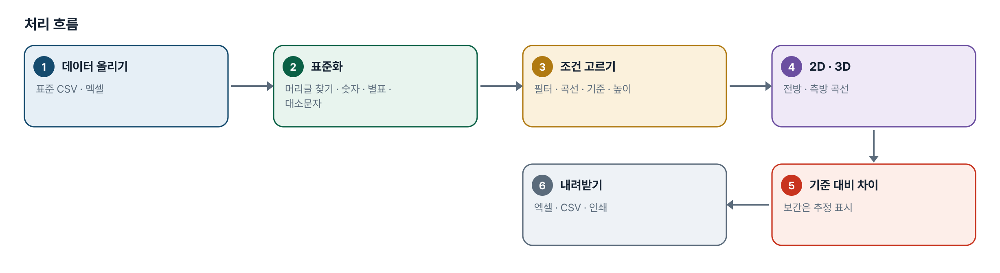
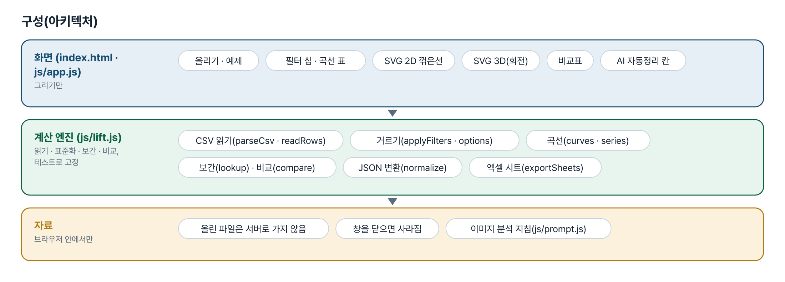
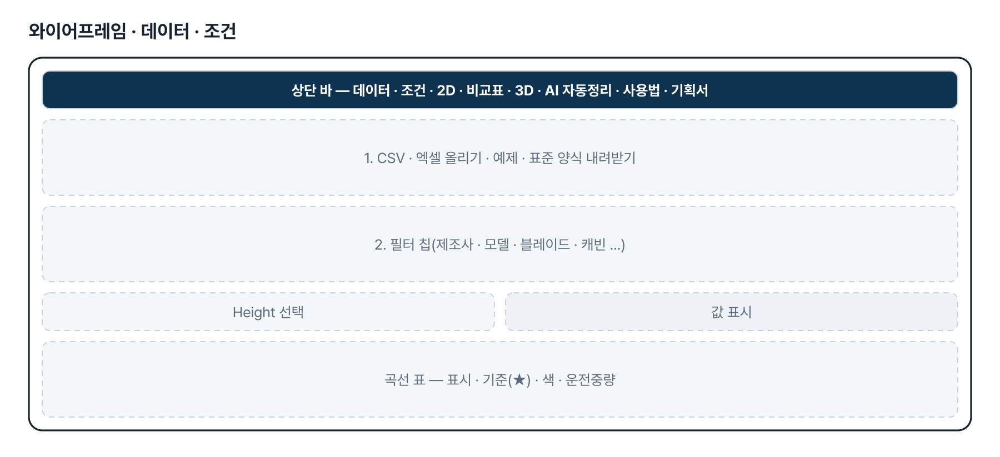
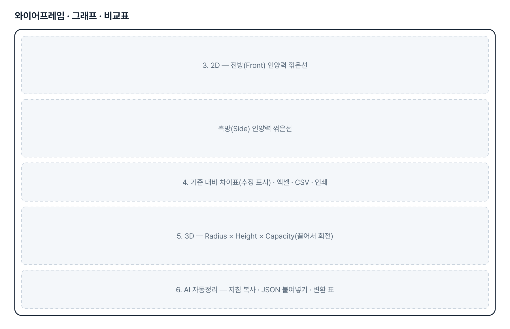
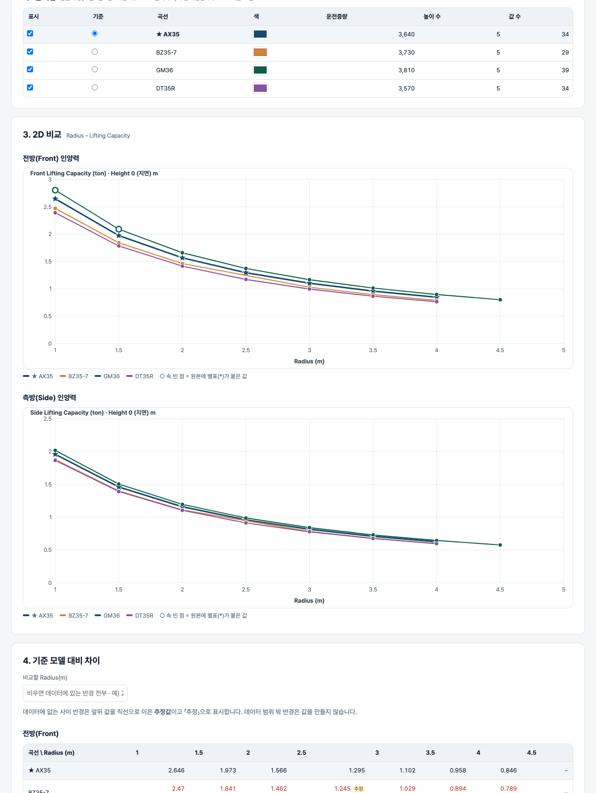

# 굴착기 인양력 비교 · 시각화 — 프로젝트 기획서 v1.0

- 기획: 조민규 · 작성일 2026-11-13 · 생성형 AI 업무자동화 전문가과정 · 2차수 프로젝트 18
- 바로 쓰기: https://build-2611-18.jobability.co.kr/
- 워드 판: `docs/기획서/build-2611-18_조민규_굴착기인양력비교시각화_기획서_v1.0.docx`

## 개요

자사 · 경쟁사 굴착기 인양력 표준 CSV(19열)를 올리면 옵션별로 걸러 전방 · 측방 인양력을 2D · 3D 로 비교하고, 기준 모델 대비 차이(%)와 엑셀 자료를 만드는 브라우저 도구입니다. 기획자가 Python(Streamlit)으로 만든 V6 프로그램을 설치 없이 쓰는 웹 판으로 옮겼습니다.

### 배경 · 현재 업무
- 신규 굴착기를 개발할 때 자사 양산 모델과 경쟁사 모델의 인양 성능을 비교하려면, 형식 · 조건 · 단위가 서로 다른 자료를 같은 형식으로 옮겨 적고 그래프를 손으로 만들어야 합니다.
- 기획자는 이를 Python(Streamlit) 프로그램 V6 로 만들어 패들릿에 올렸습니다(2026-11-12). 쓰려면 Python · VS Code 설치와 라이브러리 설치가 필요합니다.
- 같은 기능을 주소만 열면 쓰는 웹 판으로 옮겨, 설치가 어려운 동료도 표준 CSV 만 있으면 비교하도록 합니다.

### 목표
- 표준 CSV 만 올리면 옵션별 필터 · 2D/3D 비교 · 기준 대비 차이표가 바로 나옵니다.
- 값을 지어내지 않습니다 — 빈 칸은 빈 칸, 사이 반경은 「추정」 표시, 범위 밖은 값 없음.
- 경쟁사 표 이미지를 AI 로 읽은 결과(JSON)를 검증해 표준 CSV 로 바꿉니다(API 키 없이).
- 엑셀에서 차트를 바로 만들 수 있는 배치로 내려받습니다.

## 요구사항과 구현

| 기획서 요구 | 구현 |
|---|---|
| 자사 · 경쟁사 표준 CSV 업로드 | CSV · 엑셀을 여러 개 올려 이어 붙임. 머리글은 이름으로 찾음(순서 · 대소문자 무관). 못 읽은 줄은 위치와 이유를 알림 |
| 제조사 · 모델 · 블레이드 · 붐/암 · 캐빈 · 슈 · CW 필터 | 항목마다 여러 값을 눌러 고름. 다른 항목 선택에 따라 남는 값만 보임. 값이 하나면 자동으로 정해진 것으로 표시 |
| 기준 모델 설정 | 곡선 표에서 ★ 로 고름. 2D 에서 별 표식 · 굵은 선 |
| Height 선택(0m 기본) | 0m 가 있으면 0, 없으면 0 에 가장 가까운 높이 |
| 2D — Radius–Capacity Front/Side 그래프 | SVG 꺾은선 두 장(전방 · 측방). 값 표시 켜고 끄기, 곡선 색 바꾸기, 별표 값은 속 빈 점 |
| 3D — Radius × Height × Capacity | SVG 로 비춘 곡면(높이별 곡선 + 반경별 연결) · 점 모양. 끌어서 돌림. 모든 높이를 그림 |
| 특정 Radius 에서 기준 대비 차이(%)와 상세 비교표 | 반경을 적으면 그 반경만. 사이 반경은 직선 보간 + 「추정」 표시, 범위 밖은 빈 칸 |
| 엑셀 다운로드(2D Charts · Front Data · Side Data) | Front Data · Side Data · Front 비교 · Side 비교 · Rows 시트. 차트 그림은 넣지 않음(한계) |
| AI 자동정리 — 이미지 인식 → JSON 검토 → 19열 CSV | 이미지 인식은 쓰는 AI 서비스에서(지침 복사 제공). 여기서는 JSON 검증 · 단위 변환 · 옵션 표기 맞춤 · CSV 변환 · 비교로 넘기기. 규칙은 V6 core.py 와 같음 |
| 별표(*) 값 보존 | 값과 분리해 notes 의 STAR_FRONT=1 · STAR_SIDE=1 로 두고, 표 · 그래프 · 엑셀에 표시 |

## 주요 기능

- **표준 CSV 읽기** — CSV · 엑셀 여러 개를 이어 붙이고, 못 읽은 줄은 위치와 이유를 알립니다.
- **옵션별 거르기** — 제조사 · 모델 · 블레이드 · 붐/암 · 캐빈 · 슈 · CW 를 눌러 같은 조건끼리 비교합니다.
- **2D 비교** — 고른 높이에서 반경에 따른 전방 · 측방 인양력 곡선. 기준 모델은 별 표식입니다.
- **3D 비교** — 반경 × 높이 × 인양력을 한 그림에 놓고 끌어서 돌려 봅니다.
- **기준 대비 차이표** — 지정 반경의 인양력과 차이(%). 사이 반경은 「추정」으로 표시합니다.
- **AI 자동정리 변환** — AI 가 읽은 JSON 을 검증해 단위 · 표기를 맞춘 표준 CSV 로 바꿉니다.

## 처리 흐름(파이프라인)

1. **데이터 올리기** — 표준 CSV · 엑셀
2. **표준화** — 머리글 찾기 · 숫자 · 별표 · 대소문자
3. **조건 고르기** — 필터 · 곡선 · 기준 · 높이
4. **2D · 3D** — 전방 · 측방 곡선
5. **기준 대비 차이** — 보간은 추정 표시
6. **내려받기** — 엑셀 · CSV · 인쇄

## 구성(아키텍처)

- **화면 (index.html · js/app.js)** — 올리기 · 예제 · 필터 칩 · 곡선 표 · SVG 2D 꺾은선 · SVG 3D(회전) · 비교표 · AI 자동정리 칸
- **계산 엔진 (js/lift.js)** — CSV 읽기(parseCsv · readRows) · 거르기(applyFilters · options) · 곡선(curves · series) · 보간(lookup) · 비교(compare) · JSON 변환(normalize) · 엑셀 시트(exportSheets)
- **자료** — 올린 파일은 서버로 가지 않음 · 창을 닫으면 사라짐 · 이미지 분석 지침(js/prompt.js)

## 화면 구성(와이어프레임)

## 규칙 · 판정 기준

- 표준 머리글은 이름으로 찾습니다. Model · Radius (m) · Height (m) 과 Front · Side 중 하나가 없으면 읽지 않습니다.
- 빈 칸은 0 이 아니라 값 없음입니다. Model 이 비었거나 반경 · 높이가 숫자가 아닌 줄은 건너뛰고 위치와 이유를 알립니다.
- 같은 사양(제조사 · 모델 · 붐 · 암 · 캐빈 · 슈 · CW · 블레이드)이 한 곡선입니다. 곡선 이름에는 그 모델 안에서 달라지는 항목만 붙입니다.
- 기본 높이는 0m, 없으면 0 에 가장 가까운 높이입니다.
- 차이(%) = (값 − 기준) ÷ 기준 × 100. 기준 값이 없으면 차이를 내지 않습니다.
- 데이터에 없는 사이 반경은 직선 보간이며 「추정」으로 표시합니다. 범위 밖 반경은 값을 만들지 않습니다(바깥으로 늘리지 않음).
- 별표(*)는 숫자에서 떼어 notes 의 STAR_FRONT=1 · STAR_SIDE=1 로 보존합니다.
- AI JSON 변환: kg ÷ 1,000 · kN ÷ 9.80665 · lbs ÷ 2,204.62 → ton, mm ÷ 1,000 · cm ÷ 100 · ft ÷ 3.2808 → m. 단위가 적혀 있지 않으면 변환하지 않고 알립니다.
- AI JSON 변환: front_down · front_up 이 있으면 블레이드 내림 · 올림 두 행으로 나누고, 측방은 side_scope(both · up · down)에 맞는 행에만 넣습니다.

## 검증

- 계산 규칙 테스트 55개 · 화면 연기 테스트 37개 통과
- 계산 규칙 55개 — 숫자 · CSV 읽기, 표준 행 읽기와 건너뛴 이유, 거르기 · 선택지, 곡선 이름, 기본 높이, 보간, 차이(%), 단위 변환, 옵션 표기, Case 1 · 3 · 4 · 6 변환, 엑셀 시트, 예제.
- 원본 대조 — V6 의 examples/sample_case_3_raw.json 을 변환한 결과가 sample_case_3_output.csv 와 같은 값인지 개발 중 확인했고, 같은 입력을 테스트에 고정했습니다. 기획자가 올린 더미 CSV(1,296행)도 전부 읽힙니다(곡선 48개).
- 화면 — 예제 → 곡선 · 별 표식 · 색 → 비교표(추정 · 범위 밖) → 높이 · 값 표시 · 필터 · 표시 끄기 · 기준 바꾸기 → 3D 회전 · 점 · 측방 → 엑셀 · CSV 내려받아 다시 읽기 → 잘못된 파일 · 엑셀 파일 → AI JSON 변환 → 360px 넘침.

## 이번 판에서 하지 않는 것

- 이미지를 직접 올려 AI 로 읽는 기능은 없습니다(API 키를 브라우저 도구에 넣지 않기 위해). 이미지 인식은 쓰시는 AI 서비스에서 하고 결과 JSON 을 붙여 넣습니다.
- 엑셀 파일 안에 차트 그림을 만들지 않습니다. Front Data · Side Data 시트에서 범위를 잡아 차트를 넣으면 됩니다.
- 3D 는 곡선 다발로 그립니다(면을 칠한 Surface 가 아님).
- 올린 데이터는 창을 닫으면 사라집니다. 서버 저장 · 공동 편집은 없습니다.
- 예제는 가상 모델 값입니다. 실제 장비 비교에는 실제 표준 CSV 를 올려야 합니다.

## 다음 단계

- 기획자 확인 — 화면 구성과 V6 대비 빠진 기능
- 곡선 색 · 조건 저장(다음에 열어도 그대로)
- 엑셀에 차트 넣기
- 면을 칠한 3D Surface

## 버전 이력

- **v1.0** (2026-11-13) — 기획자의 V6 프로그램(Streamlit)을 웹 판으로 옮김 — 표준 CSV 읽기 · 필터 · 2D · 3D · 기준 대비 차이 · 엑셀 · AI JSON 변환
